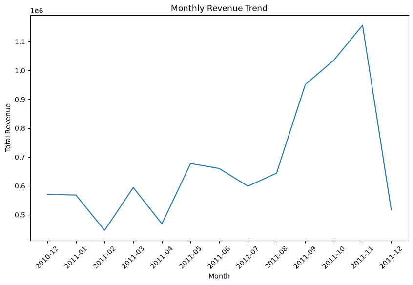
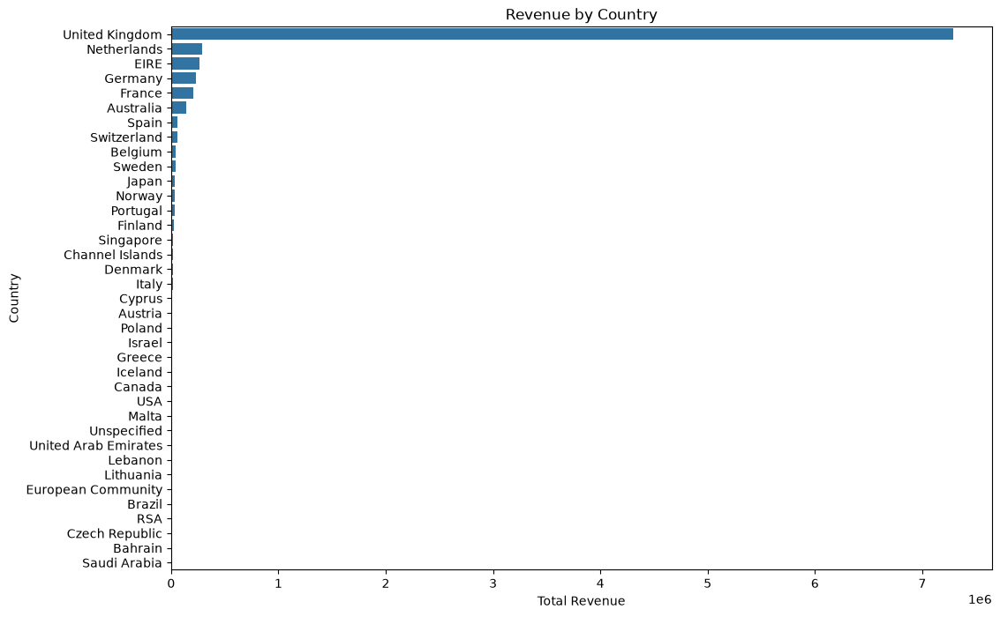

# Online Retail Sales: Data Cleaning & Analysis

Cleaning a messy e-commerce transaction dataset and turning it into clear business insights: revenue trends, best-selling products, top customers and revenue by country.

**Tools:** Python, pandas, matplotlib, seaborn, Jupyter

---

## The Problem

Raw transaction data is rarely ready to analyze. This dataset has missing customer IDs, duplicate rows, cancelled orders, and invalid quantities and prices. Left uncleaned, these distort revenue totals and customer metrics.

**Goal:** clean the data in a documented, repeatable way, then answer core sales questions.

## Dataset

[Online Retail dataset (UCI Machine Learning Repository)](https://archive.ics.uci.edu/dataset/352/online+retail): real transactions from a UK-based online retailer, December 2010 to December 2011.

- Raw rows: **541,909**
- Rows after cleaning: **392,692**

## Data Cleaning Steps

| # | Step | Rows affected | Why |
|---|------|---------------|-----|
| 1 | Dropped rows with missing `CustomerID` | 135,080 | Sales can't be attributed to a customer |
| 2 | Removed duplicate rows | 5,225 | Duplicates inflate revenue |
| 3 | Separated cancelled orders (invoices starting with "C") | 8,872 | Cancellations would distort sales totals |
| 4 | Removed rows with `Quantity <= 0` or `UnitPrice <= 0` | 40 | Data errors, not real sales |
| 5 | Standardized `Description` text (trimmed whitespace, uppercase) | - | Consistent product names |
| 6 | Converted `InvoiceDate` to datetime | - | Enables time-series analysis |
| 7 | Created a `Revenue` column (`Quantity x UnitPrice`) | - | Core metric for analysis |
| 8 | Saved the result to `online_retail_cleaned.csv` | - | Reusable clean dataset |

Result: **541,909 raw rows reduced to 392,692 clean rows, with no missing values left.**

## Key Findings

Total revenue in the cleaned data is about **£8.89M**.

### Monthly Revenue Trend
Revenue is fairly flat at £450K-£680K a month through mid-2011, then climbs sharply: September to November 2011 brings in about 35% of all revenue, peaking at £1.16M in November. December 2011 looks like a drop but is only a partial month, because the data ends early in December.



### Top Products
The best-selling items by revenue are Regency Cakestand 3 Tier (£142K), White Hanging Heart T-Light Holder (£100K) and Jumbo Bag Red Retrospot (£85K). Revenue is spread across many products rather than concentrated in a few.


### Top Customers
The top customer, ID 14646, spent about £280K, followed by 18102 (£260K) and 17450 (£194K). The top 10 customers account for roughly 17% of total revenue, so the business depends on a broad customer base.


### Revenue by Country
The United Kingdom generates about 82% of revenue. The largest export markets are the Netherlands (£285K), EIRE (£265K), Germany (£229K), France (£209K) and Australia (£138K).



## Limitations

- Cancelled orders were removed, but the original orders they reversed were not matched and removed. A few very large single orders may therefore overstate some product and customer totals.
- Non-product lines such as postage and manual adjustments are included in the revenue figures.

## Project Structure

```
sales_dashboard/
├── README.md
├── online_retail.csv             # raw data
├── online_retail_cleaned.csv     # output of the cleaning step
├── clean_data.ipynb              # cleaning, analysis and charts
├── sales_monthly_trend.png
├── sales_top_products.png
├── sales_top_customers.png
└── revenue-by-country.png
```

## How to Run

```bash
pip install pandas matplotlib seaborn jupyter
jupyter notebook clean_data.ipynb
```

Run all cells to reproduce the cleaned dataset and the charts.

## Skills Demonstrated

Data cleaning, handling missing and invalid data, feature creation, time-series analysis, data visualization, documenting a repeatable pipeline.
