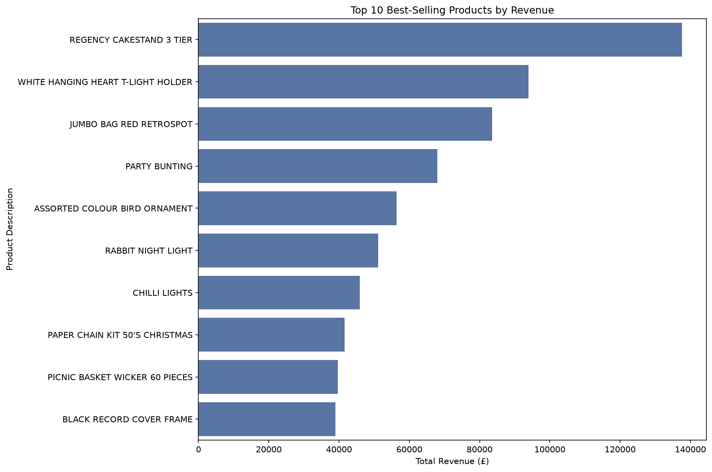
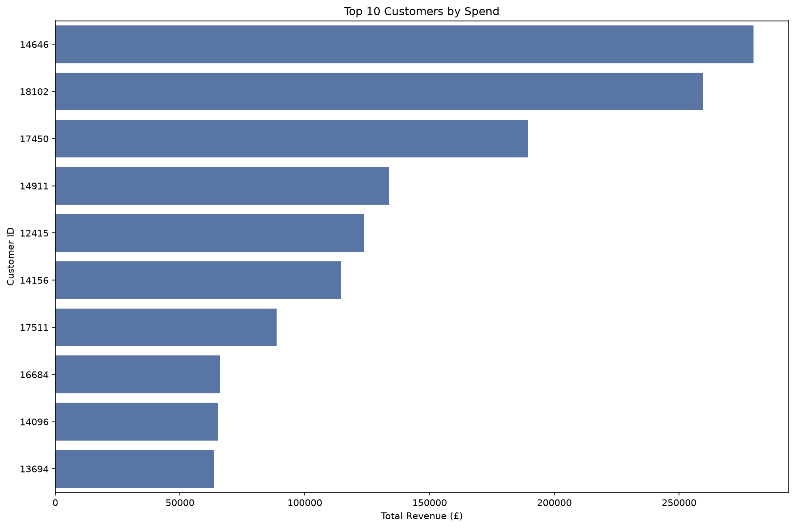

# Online Retail Sales: Data Cleaning & Analysis

Cleaning a messy e-commerce transaction dataset and turning it into clear business insights: revenue trends, best-selling products and top customers.

**Tools:** Python, pandas, matplotlib

---

## The Problem

Raw transaction data is rarely ready to analyze. This dataset has missing customer IDs, duplicate rows, cancelled orders, and invalid quantities and prices. Left uncleaned, these distort revenue totals and customer metrics.

**Goal:** clean the data in a documented, repeatable way, then answer core sales questions.

## Dataset

[Online Retail dataset (UCI Machine Learning Repository)](https://archive.ics.uci.edu/dataset/352/online+retail): real transactions from a UK-based online retailer.

- Raw rows: **[ADD raw row count]**
- Rows after cleaning: **[ADD cleaned row count]**

## Data Cleaning Steps

| # | Step | Why |
|---|------|-----|
| 1 | Dropped rows with missing `CustomerID` | Sales can't be attributed to a customer |
| 2 | Removed duplicate rows | Duplicates inflate revenue |
| 3 | Separated cancelled orders (invoices starting with "C") | Cancellations would distort sales totals |
| 4 | Removed rows with `Quantity <= 0` or `UnitPrice <= 0` | Data errors, not real sales |
| 5 | Standardized `Description` text (trimmed whitespace, uppercase) | Consistent product names |
| 6 | Converted `InvoiceDate` to datetime | Enables time-series analysis |
| 7 | Created a `Revenue` column (`Quantity x UnitPrice`) | Core metric for analysis |
| 8 | Saved the result to `cleaned_online_retail.csv` | Reusable clean dataset |

## Key Findings

### Monthly Revenue Trend
[ADD one sentence on the trend, e.g. which months peak and whether sales grow toward year-end.]


### Top Products
[ADD one sentence on the top products, e.g. what the best seller is and whether sales are concentrated in a few items.]



### Top Customers
[ADD one sentence on the top customers, e.g. how much revenue the top 10 customers contribute.]



## Project Structure

```
01-sales-dashboard/
  online_retail.csv             # raw data
  cleaned_online_retail.csv     # output of the cleaning step
  clean.ipynb                   # cleaning pipeline & analysis and charts
  sales_monthly_trend.png
  sales_top_products.png
  sales_top_customers.png
  README.md
```

## How to Run

```bash
pip install pandas matplotlib
python clean_data.py
python analyze_data.py
```

## Skills Demonstrated

Data cleaning, handling missing and invalid data, feature creation, time-series analysis, data visualization, documenting a repeatable pipeline.
